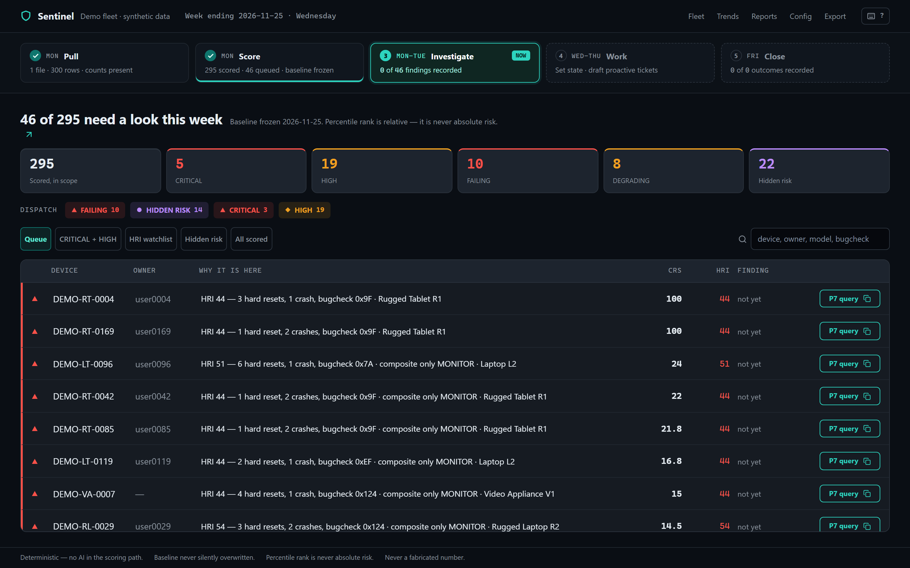
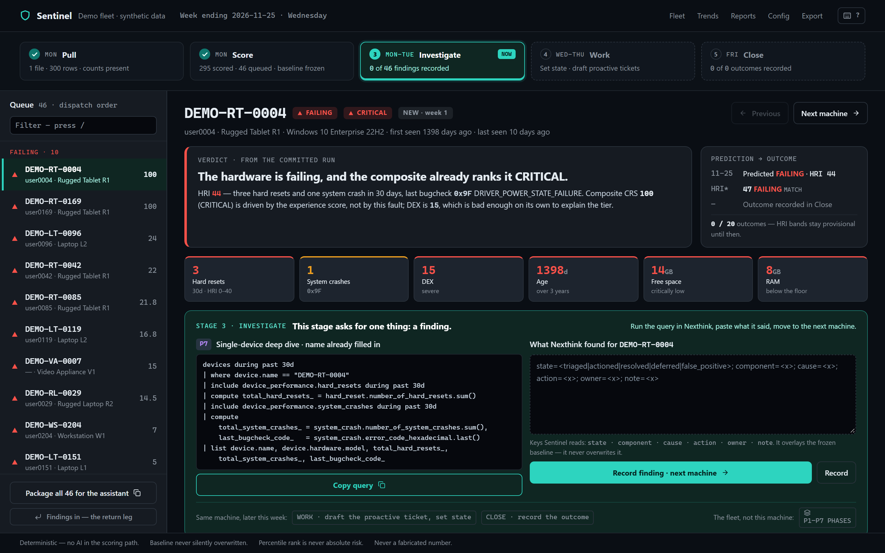

# Sentinel

An offline, deterministic console for a weekly proactive device-health loop over endpoint
telemetry, designed for Nexthink exports. It turns one weekly CSV into a ranked, explained work
queue, drafts the remediation ticket, and keeps an outcome ledger so the scoring can be checked
against what actually happened.

This public version runs on **synthetic data** (`demo/sample-fleet.csv`). It was originally built
for a weekly device-health review on a large enterprise fleet; every organisation-specific detail
(form fields, query scopes, naming conventions, device models) has been replaced with a neutral
equivalent.



## The problem

Most service desks learn that a laptop is failing when its user calls. Endpoint analytics tools
already collect the signals that come first: hard resets, kernel crashes, application crash
volume, low disk, age, a falling experience score. What a dashboard does not do is tell a small
team which twenty devices to touch this week, explain why each one is on the list, or say whether
last month's calls were right. Sentinel does those three things.

## The weekly loop

| Stage | When | What it asks for |
|---|---|---|
| **Pull** | Mon | The export. Choosing files only reads and reports (column coverage, null rates, a clean / review / block gate); a separate button freezes the week's baseline |
| **Score** | Mon | Nothing to enter: KPIs, the dispatch ladder, the triage table |
| **Investigate** | Mon–Tue | A finding per device. The query is pre-filled with the device name; paste back what it showed |
| **Work** | Wed–Thu | A state (triaged / actioned / resolved / deferred / false positive) and a ticket draft |
| **Close** | Fri | The outcome: confirmed failure or not, and the lead time. This is the only input that moves precision, recall and lead time |

Lenses that sit outside the loop: **Fleet** (composition and what changed since last run),
**Trends** (DEX, CRS, tier movement, hidden risk, validation over committed weeks), **Reports**
(weekly status and an executive brief, generated as plain text), **Config**, and **Export**
(backup and restore).



## Scoring design

Three models, kept deliberately separate:

- **CRS — Composite Risk Score (absolute, 0–100).**
  `(DEX×20 + crash×20 + age×15 + RAM×10 + storage×15 + OS×10 + availability×10) / 100`, with tiers
  at 52 / 38 / 25 / 12 (CRITICAL / HIGH / ELEVATED / MONITOR). A missing experience score counts as
  40 points, not 0: unknown risk is not zero risk, and a device with no score must never sort as
  healthy. Crash volume has an extra band at ≥500 so a runaway device separates from a merely bad
  one. OS currency matches "Windows 10", never a bare "10".
- **HRI — Hard-reset Risk Index (event counts).** Hard resets plus system crashes, plus a small
  uptime-creep term only when one of those is present. Bands 40 / 20 / 8 map to FAILING /
  DEGRADING / WATCH. It is built on raw counts rather than vendor subscores because subscores
  saturate: three resets and thirty can read the same.
- **Triage rank (relative percentile).** Stored in its own field and never presented as absolute
  risk.

A device that HRI flags while CRS calls it healthy is **hidden risk**: the hardware is failing
beneath a good experience score. That is the case nothing else in the stack surfaces, and the
queue puts it second, after FAILING.

### Why HRI stays provisional

The HRI bands are a hypothesis, not a measurement. Until the outcome ledger holds 20 graded
outcomes, the interface labels HRI provisional and tuning refuses to propose anything. After
that, precision, recall and average lead time come from the ledger, and a band change is
*proposed* only when the numbers call for it: precision under 60% with at least three false
positives proposes tightening the WATCH edge; recall under 70% with two or more missed failures
proposes lowering FAILING. Nothing is applied automatically, and at most one change is allowed per
60 days, so each change gets a full cycle of outcomes before the next one. Otherwise there is no
way to tell which change moved the numbers.

An experimental alternative curve, HRI\* (`src/core/hristar.ts`), is computed into parallel
fields for comparison. It never drives dispatch, and a test pins HRI\* ≥ HRI on every device.

## Guardrails

- **Deterministic.** No AI in the scoring path; the same export and config always give the same
  queue. The scoped investigation package can be handed to an AI assistant to draft queries, but
  what comes back is parsed into an overlay and never rescored.
- **Never submits a ticket.** Work drafts a 13-field Proactive Ticket, each value marked
  *suggested* or *overridden*, plus a generic incident payload. The operator copies it into their
  ticketing system. There is no submit control to remove.
- **Baseline never silently overwritten.** Committing freezes the week; findings land in an
  overlay with a changelog; Pull spells out what committing replaces and refuses when the ingest
  gate says `block`.
- **One band change per 60 days**, proposed and never auto-applied.
- **Owner attribution is unverified.** Admin, service and shared accounts (configurable patterns)
  are excluded from dispatch and flagged "verify owner" on drafts. The owner's name is never
  invented; the export carries an ID only.
- **Never a fabricated number.** A missing column is reported as missing, not scored as zero.
  Weeks without full tier data are drawn as such on Trends rather than as an invented split.
- **Config applies to the next scoring pass.** A committed run is never silently rescored.

## Architecture

```
src/core/    pure TypeScript: ingest, scoring, queue, investigate, tickets, validation,
             reports, trends, store-core. No React, no DOM, no globals: config and the
             store are passed in as parameters, so everything is unit-testable.
src/store/   zustand binding and the storage adapter (one localStorage key, one JSON blob)
src/app/     React UI: stage rail, workspace (queue picker + device dossier), lenses, sheets
demo/        sample-fleet.csv: 300 synthetic devices
scripts/     make-sample-fleet.mjs (seeded generator); Playwright file:// checks (Python)
```

- **One file, no server.** A small Vite plugin inlines the JS and CSS into a single
  `dist/index.html`, and routing uses a hash router, so the build runs by double-click from
  `file://`. The target was a locked-down workstation where installing software was not an
  option. State lives in localStorage; Export downloads a dated backup and Import shows both sides
  before replacing anything.
- **Schema-adaptive ingest.** Columns are matched by name through an alias map; several exports
  merge on device name (fill gaps, first file wins). The field contract is `SCHEMA_MAP` in
  `src/core/ingest.ts`, and a test checks the documented export query against it so the two
  cannot drift.
- **Stack:** React 19, TypeScript (strict), Vite, zustand, React Router, Recharts, Tailwind with
  shadcn/ui primitives, motion. Tests: Vitest and Testing Library (jsdom).

The queries in `src/core/nql.ts` and `src/core/phases.ts` are short illustrative NQL sketches
scoped to a placeholder entity, not a production query suite.

## Run it

```
npm install
npm run dev        # http://localhost:5173
npm test           # 235 tests, Vitest
npm run build      # one self-contained file: dist/index.html
```

On the **Pull** stage, choose `demo/sample-fleet.csv`, set a week-ending date and commit. The
sample is 300 invented devices with a few planted cases so there is something to find: 5 CRITICAL
and 19 HIGH composite scores, 10 HRI FAILING devices, 22 hidden-risk devices, one rugged-tablet
model cluster sharing a stop code, unattended appliances with no experience score at all, and 5
service or shared accounts that are excluded however bad the device looks. Commit it under two
or three different dates to populate Trends.

`node scripts/make-sample-fleet.mjs` regenerates the file from a fixed seed, byte for byte.
After a build, `python scripts/verify-file-protocol.py` and `python scripts/verify-phase3.py`
drive `dist/index.html` from `file://` in Chromium (needs Python Playwright).

## Known limitations

This is a faithful port of an earlier vanilla-JS console, and two of that console's bugs were kept
on purpose rather than fixed silently during the port. Both are marked in the code and on screen:

- **B-06** (`src/core/reports.ts`): "actions taken this week" reads the whole changelog, so a later
  week can claim credit for an earlier one until the changelog is cleared. The Roundup sheet is
  where it gets cleared after the Friday report, and the Reports screen says so.
- **B-08** (`src/core/ingest.ts`, `src/core/scoring.ts`): an export carrying hard resets but no
  system-crash column reports HRI as unavailable at ingest while every device still scores. A
  combined export, which is the documented path, is unaffected.

## How this was built

Designed and specified by Arqueveon Walker; implemented with Claude (Anthropic) from his written
specs, then reviewed and tested.

## License

MIT. See [LICENSE](LICENSE).
